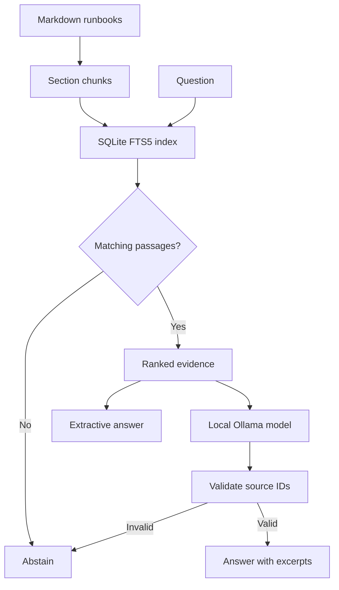

# Runbook RAG


An operator investigating a growing queue needs an answer they can check against a runbook. Ask **“What should I compare when queue depth rises?”** and the API returns a passage about arrival and completion rates, its section title, and the source file. The three included runbooks are original synthetic examples.

## Architecture



FastAPI exposes the question endpoint and an interactive client at `/docs`. BM25 ranking and English stemming work well for concrete terms such as DNS and packet loss. A request builds an in-memory index over six sections, which keeps the demo reproducible. Each section is a retrieval unit. Local model mode sends up to three passages to Ollama and checks the returned citation identifiers. A valid identifier establishes provenance. Human review or a separate evaluation is needed to establish whether a passage actually supports the generated claim.

## Try it locally

Use Python 3.12 with SQLite FTS5 support. From the repository root:

```bash
python -m venv .venv
source .venv/bin/activate  # Windows PowerShell: .venv\Scripts\Activate.ps1
python -m pip install -r requirements-dev.txt
python -m unittest discover -s tests -v
python -m uvicorn src.app:app --port 8000
```

Open http://localhost:8000/docs, expand **POST /ask**, choose **Try it out**, and send:

```json
{"question":"What should I compare when queue depth rises?"}
```

The default extractive response quotes the highest-ranked passage. Try an unrelated question such as “How do I bake pancakes?” to see abstention.

## Docker and generation

For a quick offline-model-free demonstration run `docker compose up --build -d api`. For full retrieval-augmented generation, use the following from the same directory. The initial model download needs internet access and disk space.

```bash
cp .env.example .env
docker compose --profile llm up --build -d
docker compose exec ollama ollama pull qwen2.5:0.5b
```

Send the same question at `/docs`. Inspect `mode`, the answer, and each cited excerpt. A model timeout or malformed response returns HTTP 502. Unsupported citations return abstention. Stop with `docker compose --profile llm down`. Windows PowerShell supports `Copy-Item .env.example .env` for the first command.

| Setting | Default when omitted | Purpose |
| --- | --- | --- |
| ANSWER_MODE | extract | Use generate for Ollama-backed answers |
| OLLAMA_MODEL | qwen2.5:0.5b | Installed model tag |
| OLLAMA_URL | localhost:11434 with http scheme locally, http://ollama:11434 in Compose | Model endpoint reachable by the API |

## Evaluation and deployment

The tests check the first-ranked source for four labeled questions, exercise no-match behavior and input validation, and simulate valid citations, invented citations, and a generation timeout. This small fixture measures retrieval regressions. To evaluate a different model, record its tag and score answer support and abstention on held-out questions.

For a Docker-based AWS demo, provision a Linux EC2 host with Docker Compose, restrict SSH to your IP, clone this repository on the host, and run the Compose commands above. From your laptop forward the private API with `ssh -L 8000:localhost:8000 USER@HOST` and open the local docs URL. For a public demo, put TLS, request limits, and authentication in front of the API. Keep the model service private. Stop the host when finished.

**Next engineering milestone:** persist the index at ingestion, add a paraphrase-heavy evaluation set, then compare lexical and embedding retrieval on the same questions.
